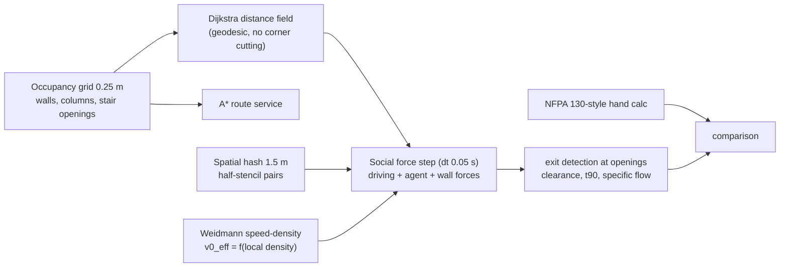
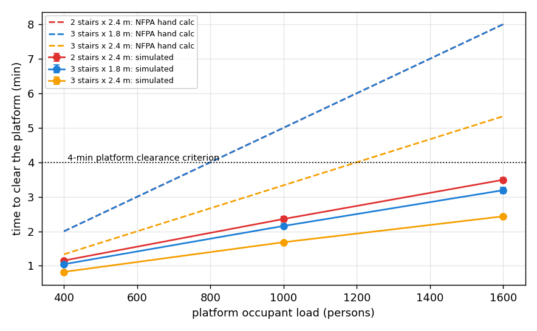

# transit-hub-pedestrian-egress

**Metro platform evacuation: microsimulation vs. the NFPA 130 hand calculation.** A vectorised
Helbing social-force model (spatial hashing, Weidmann speed-density coupling) evacuates an island
platform through stair openings, steered by a Dijkstra distance field; an A* service answers
individual routes. Results are compared with an NFPA 130-style capacity calculation across occupant
loads and stair layouts.

**Headline (50 runs, 5 seeds per cell):** the NFPA hand calculation was **1.6-2.5× more conservative**
than the simulation, and **most of that gap is a limitation of the simulation**: it ends at the stair
*entry* at level-walking flow, while NFPA charges the slower stair *ascent* capacity. Layout also matters
beyond total width: three 1.8-m stairs and two 2.4-m stairs are identical in the hand calculation, but the
simulation clears the three-stair layout 9% faster (shorter walks).

---

## 1. Problem formulation

NFPA 130 requires a station platform's occupant load to clear the platform within **4 minutes** (and reach
a point of safety within 6). Designers check this with a capacity hand calculation, and increasingly with
pedestrian microsimulation (Legion, Pathfinder, MassMotion). Knowing *why* the two differ is what lets an
engineer defend a design to the authority having jurisdiction (AHJ).

| Bar | Here |
|---|---|
| **Engineering** | Island platform 120 × 10 m, columns, 2-3 stair openings; NFPA 130-style capacity calc; 4-min criterion; occupant-load sweep |
| **Modelling** | Social-force dynamics, Weidmann fundamental diagram, specific flow checked against empirical bottleneck data, documented failure modes |
| **Systems** | O(N) neighbour search (spatial hash, half-stencil), single precomputed geodesic field (Dijkstra) shared by every agent, A* routing API, process-pool sweep |

---

## 2. Architecture



---

## 3. Methodology

**Social force** (Helbing, Farkas & Vicsek 2000), per agent: $m\,\dot{\mathbf v}_i = m(v^{eff}_{0,i}\mathbf e_i-\mathbf v_i)/\tau + \sum_j\big[A e^{(r_{ij}-d_{ij})/B}+k\,g(\cdot)\big]\mathbf n_{ij} + \kappa\,g(\cdot)\,\Delta v^t_{ji}\mathbf t_{ij}$ + walls.
$m$ = 80 kg, $\tau$ = 0.5 s, $A$ = 2,000 N, $B$ = 0.08 m. The contact stiffnesses are softened 10× (to $k$ = 1.2e4) so
a 0.05-s explicit step is stable.

**Weidmann coupling.** With soft contacts alone, the first test produced 3.4 p/m/s through a stair opening,
about twice empirical values. Desired speed is therefore scaled by Weidmann's fundamental diagram,
$v_{0}^{eff} = v_0[1-e^{-1.913(1/\rho - 1/5.4)}]$, with $\rho$ the density within 1 m. Measured specific flows are then
**1.38-1.71 p/m/s** at $v_0$ = 1.34 m/s, within the range reported in laboratory bottleneck experiments.

**Navigation.** An 8-connected Dijkstra field from the stair openings (kept 0.3 m clear of the jambs) gives every
agent's desired direction as steepest descent, and agents on a target cell head straight out. Two navigation traps
found during testing (agents freezing at an opening jamb, and agents standing on a target cell) are fixed and
documented in the code.

**NFPA 130-style hand calculation.** Each stair's effective width is its width minus 0.3 m per side, times
55.5 p/m/min (stair ascent). Occupants are split by capacity, and the platform clearance time is the larger of
queueing time and the longest walk at 38 m/min. These values are configurable; check them against the edition
and AHJ interpretation for your project.

---

## 4. Results ([`results/platform/RESULTS.md`](results/platform/RESULTS.md))



| Layout | Occupants | Simulated clearance | NFPA hand calc | NFPA / sim | 4-min check (sim / NFPA) |
|---|---|---|---|---|---|
| 3 stairs × 2.4 m | 400 | 0.82 min | 1.33 min | 1.62 | pass / pass |
| 3 stairs × 2.4 m | 1,000 | 1.68 | 3.34 | 1.98 | pass / pass |
| 3 stairs × 2.4 m | 1,600 | 2.44 | 5.34 | 2.19 | pass / **fail** |
| 3 stairs × 1.8 m | 1,000 | 2.16 | 5.01 | 2.32 | pass / **fail** |
| 2 stairs × 2.4 m | 1,000 | 2.36 | 5.01 | 2.12 | pass / **fail** |
| 2 stairs × 2.4 m | 1,600 | 3.50 | 8.01 | 2.29 | pass / **fail** |

**Engineering reading.**

* **Where the conservatism comes from.** The simulation's stair-entry flow (about 1.4-1.7 p/m/s, roughly 85-100 p/m/min)
  is level-walking flow. NFPA charges the stair ascent at 55.5 p/m/min on an effective width 0.6 m narrower. Most
  of the 2× gap is that difference, so **this simulation overstates platform performance** until the stairs
  themselves are modelled. Do not take "the sim passes, NFPA fails" as evidence that the design is fine.
* **The gap grows with load** (1.6× → 2.5×) because queueing at the stairs dominates, and the queue is exactly where
  the capacity assumptions differ.
* **Distribution beats width.** Equal effective width, different outcome: three 1.8-m stairs clear 9% faster than
  two 2.4-m stairs (2.16 vs 2.36 min at 1,000 people), because the farthest walk is shorter. The hand calculation
  cannot see this.
* **Negative result: "faster is slower" is not reproduced.** Raising desired speed to 2 m/s *cut* clearance
  (2.44 → 1.60 min) and pushed specific flow to 2.5 p/m/s, above empirical values. Clogging at exits needs stiff
  contact and friction forces, which the softened, density-capped model removes for stability. This model should not
  be used for panic or crush scenarios.

---

## 5. Layout, reproduce, limitations

```
src/egress/geometry.py     grid, exits, Dijkstra field, A*, standard platform
src/egress/socialforce.py  vectorised social force, spatial hash, Weidmann coupling, exit accounting
src/egress/nfpa.py         NFPA 130-style hand calculation
src/egress/study.py, api/app.py (/v1/route, /v1/nfpa), cli.py
tests/ (6 tests: distance field, A* around obstacles, neighbour search completeness, evacuation sanity, hand calc, API)
```

```bash
python -m venv .venv && .venv/Scripts/activate
pip install -r requirements.txt && pip install --no-deps -e .
pytest && egress study --seeds 5 --workers 2      # ~27 min on a 4-core laptop
```

**Limitations.** No stair ascent, escalators or fare gates (the next model element to add); a uniform initial
distribution with no train unloading surge; softened contacts (not for crush or panic); no smoke or tenability analysis.
The NFPA parameters are configurable defaults, not code citations for a specific edition.

## License

MIT
