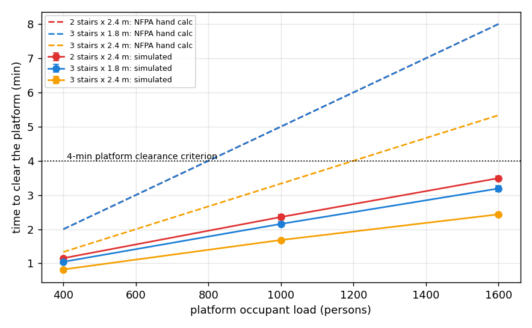

# Platform evacuation results

50 runs (5 seeds per cell) in 1616 s. Clearance = time the last person leaves the platform.

| Layout | Occupants | Desired speed | Simulated clearance (min) | t90 (min) | Specific flow (p/m/s) | Peak local density (p/m²) | NFPA hand calc (min) | NFPA / sim | Meets 4 min (sim / NFPA) |
|---|---|---|---|---|---|---|---|---|---|
| 2 stairs x 2.4 m | 400 | 1.34 m/s | 1.15 ± 0.03 | 0.94 | 1.39 | 1.8 | 2.00 | 1.74 | yes / yes |
| 2 stairs x 2.4 m | 1000 | 1.34 m/s | 2.36 ± 0.08 | 1.95 | 1.62 | 2.6 | 5.01 | 2.12 | yes / NO |
| 2 stairs x 2.4 m | 1600 | 1.34 m/s | 3.50 ± 0.07 | 2.94 | 1.71 | 2.9 | 8.01 | 2.29 | yes / NO |
| 3 stairs x 1.8 m | 400 | 1.34 m/s | 1.05 ± 0.02 | 0.81 | 1.43 | 2.0 | 2.00 | 1.91 | yes / yes |
| 3 stairs x 1.8 m | 1000 | 1.34 m/s | 2.16 ± 0.06 | 1.76 | 1.60 | 2.6 | 5.01 | 2.32 | yes / NO |
| 3 stairs x 1.8 m | 1600 | 1.34 m/s | 3.19 ± 0.09 | 2.63 | 1.70 | 2.8 | 8.01 | 2.51 | yes / NO |
| 3 stairs x 2.4 m | 400 | 1.34 m/s | 0.82 ± 0.02 | 0.64 | 1.38 | 1.9 | 1.33 | 1.62 | yes / yes |
| 3 stairs x 2.4 m | 1000 | 1.34 m/s | 1.68 ± 0.03 | 1.36 | 1.56 | 2.5 | 3.34 | 1.98 | yes / yes |
| 3 stairs x 2.4 m | 1600 | 1.34 m/s | 2.44 ± 0.05 | 2.03 | 1.66 | 2.8 | 5.34 | 2.19 | yes / NO |
| 3 stairs x 2.4 m | 1600 | 2.00 m/s | 1.60 ± 0.03 | 1.34 | 2.52 | 3.0 | 5.34 | 3.33 | yes / NO |

